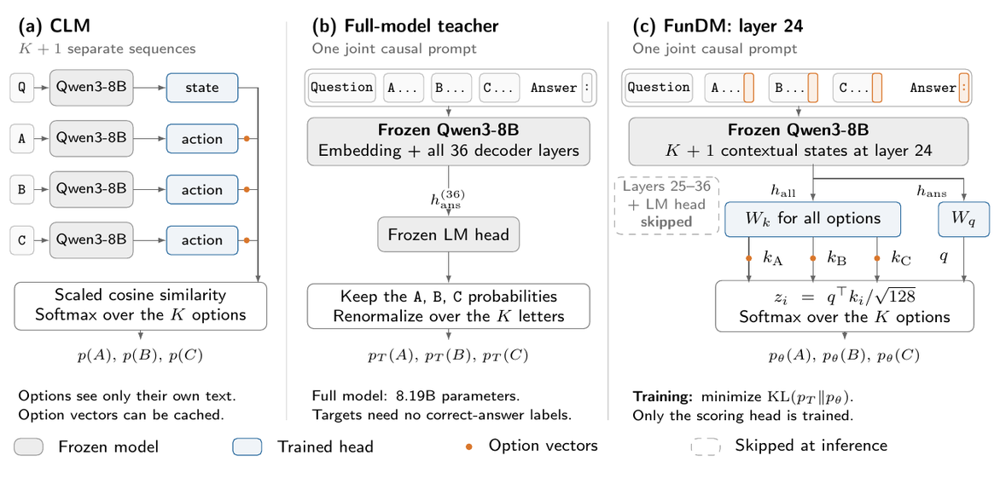

<div align="center">

# FunDM: Cheap & Label-Free Decision Models from Frozen Language Models

**Reuse pretrained capability. Train a small decision head label-free.**


[](LICENSE)

</div>

FunDM turns a pretrained language model into a decision model by training a small head
on its answer probabilities. The backbone stays frozen. Head fitting and checkpoint
selection need no correct-answer labels.



<sub>Question and options share one causal pass. Teacher-only KL trains the head; inference skips the last 12 layers and LM head. +1T adds a bidirectional transformer over the option and query states.</sub>

- **Cheap training:** 1.05M trainable parameters (5.38M for +1T). On the original 38k
  MCQ pool, caching teacher probabilities and states at five depths takes ~16 minutes on
  one DGX Spark; each head fits in under 30 seconds.
- **Accuracy retained:** +1T keeps **99.2% of the teacher's eight-benchmark mean
  accuracy**, using 24 of 36 layers.
- **Efficient inference:** **1.56–1.57× throughput**, ~**33% less GPU allocator
  memory**, and ~**38% lower first-decision latency** than the full model on MMLU-Pro.

## Results

MCQ: eight-benchmark mean accuracy. CoderForge: tasks solved out of 100, with five-seed
mean ± SD for trained heads.

| Model | MCQ accuracy | CoderForge tasks solved |
|---|:-:|:-:|
| CLM, released | 44.3% | 44.0 |
| CLM, fine-tuned | 46.4% | 58.2 ± 3.4 |
| CLM-shaped, from scratch | 35.7% | 52.0 ± 4.2 |
| FunDM | 74.7% | **74.6 ± 1.5** |
| FunDM+1T | **75.0%** | 74.4 ± 2.2 |
| Full-model teacher | 75.7% | 74 |

Agent training/scoring protocols differ; similar means do not establish equivalence.
CLM's post-training collection overlaps the test set. [Full comparisons and
caveats](docs/reproduction.md#detailed-results).

## Inference efficiency

Native vLLM, the same 500 MMLU-Pro questions, one DGX Spark:

| Model | Layers | Peak CUDA reserved (GiB) | Questions/s | First decision (ms) | Speedup |
|---|:-:|:-:|:-:|:-:|:-:|
| CLM, released | 36 | 19.3 | 16.8 | 216.7 | 0.69× |
| Full model + LM head | 36 | 20.5 | 24.5 | 93.7 | 1.00× |
| FunDM | 24 | **13.8** | **38.4** | **57.6** | **1.57×** |
| FunDM+1T | 24 | **13.8** | 38.2 | 58.3 | 1.56× |
| FunDM-CE | 36 | 19.8 | 29.5 | 84.5 | 1.20× |
| FunDM-CE+1T | 36 | 19.6 | 29.5 | 86.9 | 1.20× |

Memory covers the PyTorch allocator; other CUDA allocations are excluded. Latency is
batch-one engine time, excluding tokenization, HTTP, and queueing. CLM caches are
enabled and cleared between timed passes.

[Protocols and prepared-option results](docs/reproduction.md#inference-measurements) ·
[Raw measurements](assets/serving-data.json).

## Get started

[Environment setup](docs/reproduction.md#setup) · [Train on your own
choices](docs/reproduction.md#training-options)

```bash
.venv/bin/python main.py --table 1  # benchmark comparison
.venv/bin/python main.py --all      # complete reproduction
```

[Download the paper caches](docs/reproduction.md#download-paper-caches) to reuse
feature extraction (~65 GiB; Qwen3-8B only). Missing inputs are rebuilt automatically;
a full rebuild takes ~3 GPU-days on one DGX Spark.

[Code](scripts/README.md) · [Figures and reports](assets/README.md) ·
[Results](results/README.md) · [Docs](docs/README.md) · [Tests](tests/README.md) ·
[Dependencies](third_party/README.md)

Original code: [Apache 2.0](LICENSE). Third-party code retains its own licenses.

## Citation

[Read the paper on arXiv](https://arxiv.org/abs/2610.17175).

```bibtex
@misc{panchal2026fundmcheaplabelfree,
  title={FunDM: Cheap \& Label-Free Decision Models from Frozen Language Models},
  author={Ujjawal K. Panchal},
  year={2026},
  eprint={2610.17175},
  archivePrefix={arXiv},
  primaryClass={cs.LG},
  url={https://arxiv.org/abs/2610.17175},
}
```
