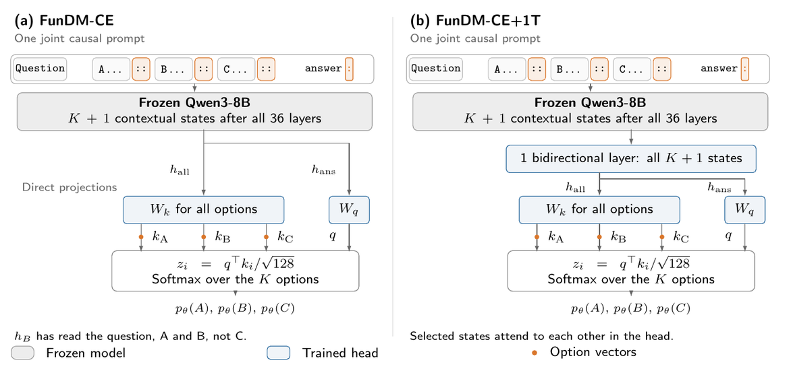

# Reproducing FunDM

[Back to the overview](../README.md). This guide contains environment setup, full comparisons, measurement protocols, and commands. Run commands from the repository root.

## Setup

Tested on a DGX Spark with Python 3.14 and CUDA 13.0. Clone the
repository with its CLM submodule, then install both pinned environments:

```bash
git clone --recurse-submodules https://github.com/Ujjawal-K-Panchal/FunDM.git
cd FunDM
python3.14 -m venv .venv
.venv/bin/pip install -r requirements-lock.txt --extra-index-url https://download.pytorch.org/whl/cu130
python3.14 -m venv .venv-clm
.venv-clm/bin/pip install -r requirements-clm-lock.txt --extra-index-url https://download.pytorch.org/whl/cu130
```

Use `.venv` for FunDM and `.venv-clm` for the CLM/vLLM steps. Run all
commands below from the repository root.

## Download paper caches

The [paper cache collection](https://huggingface.co/datasets/bulbface/FunDM-caches)
contains about 65 GiB of Qwen3-8B features, teacher scores, and baseline embeddings.
It excludes the 27B cache, model weights, trained heads, and raw questions/trajectories.
Source-specific terms apply; mixed SciQ/RACE training caches are for non-commercial
research. Read the dataset card and `LICENSES.md` before reuse.

From a fresh clone after environment setup, download the pinned release and verify
its SHA-256 checksums. The allow-list preserves this repository's README and license:

```bash
.venv/bin/python - <<'PYTHON'
import hashlib
import json
from pathlib import Path
from huggingface_hub import hf_hub_download, snapshot_download

repo = "bulbface/FunDM-caches"
revision = "50f7c579daab286fce99ad808852add757c160f5"
manifest_path = hf_hub_download(repo, "manifest.json", repo_type="dataset", revision=revision)
manifest = json.loads(Path(manifest_path).read_text())
snapshot_download(repo, repo_type="dataset", revision=revision, local_dir=".",
                  allow_patterns=[item["path"] for item in manifest["files"]])
for item in manifest["files"]:
    path = Path(item["path"])
    digest = hashlib.sha256()
    with path.open("rb") as stream:
        for block in iter(lambda: stream.read(8 * 1024 * 1024), b""):
            digest.update(block)
    assert path.stat().st_size == item["bytes"], path
    assert digest.hexdigest() == item["sha256"], path
print(f"Verified {len(manifest['files'])} cache files.")
PYTHON
```

Then run the table commands below. Caches skip feature extraction; missing head fits,
baseline evaluations, upstream datasets, and model/head downloads still run as needed.
Tables 2 and 12 use archived timing reports unless you supply a fresh report.

The split map uses opaque IDs instead of question text. All 25 checked splits are
unchanged, including the expanded pool. Historical KD caches retain their
`old-structured` prompt metadata and are intended for `kd_train` and the paper-table
workflow; use the custom `extract` workflow for checkpoints intended for raw `predict`.

## Paper tables and figures

| Command | Paper |
|---|---|
| `--table 1` | FunDM versus CLM baselines and the full model on eight benchmarks |
| `--table 2` | Inference: released CLM, the teacher, FunDM, FunDM+1T, FunDM-CE, and FunDM-CE+1T |
| `--table 3` | CoderForge selection: FunDM, CLM baselines, and the full-model judge |
| `--table 4` | Matched layer-24 targets: correct labels, hard teacher targets, teacher probabilities |
| `--table 5` | Original supervised CE recipe across eight benchmarks |
| `--table 6` | CE encoding: option only, question + option, full list (MMLU-Pro) |
| `--table 7` | CE head architecture on joint final-layer states |
| `--table 8` | FunDM accuracy versus exit depth |
| `--table 9` | FunDM validation KL by depth |
| `--table 10` | FunDM with the 38k versus 123k training pool |
| `--table 11` | DeepSWE supervised heads on separate released embeddings |
| `--table 12` | Throughput of CLM, original CE, and FunDM heads by depth |
| `--figure 3` | Exact per-benchmark accuracies and displayed teacher-relative retention |
| `--figure 4` | CoderForge depth sweep: means and five-seed standard deviations |
| `--text prompt`, `option-order`, `timing`, `overlap` | Prompt, option-order, timing and data-split diagnostics |
| `--text clm-coderforge` | Released CLM on CoderForge, and the overlap with its training data (ADP) |

- **Caches:** the selected paper release is about 65 GiB; use the download command above to restore its directory layout.
- **No caches:** `main.py` rebuilds what is missing, about 3 GPU-days in all; `--caches` builds everything up front.
- **Hardware:** one NVIDIA DGX Spark (GB10, CUDA 13.0, Python 3.14).

For CoderForge, `--table 3` and `--all` automatically create `data/clm_emb/coderforge-swerebench-8k/holdout.json` from the published `holdout` list in [`results/coderforge/tasks.json`](../results/coderforge/tasks.json) before CLM fine-tuning. This preparation also runs with `--caches` and works when embedding caches already exist; no manual split-file creation is needed.

## Detailed results

Eight benchmarks (MMLU-Pro, MMLU, OpenBookQA, CommonsenseQA, PIQA, HellaSwag, WinoGrande, BoolQ), one frozen Qwen3-8B:

| | CLM | CLM ft. | CLM-shaped | FunDM | FunDM+1T | Full model |
|---|:-:|:-:|:-:|:-:|:-:|:-:|
| Mean accuracy | 0.443 | 0.464 | 0.357 | 0.747 | **0.750** | 0.757 |
| Layers run (of 36) | 36 | 36 | 36 | **24** | **24** | 36 + LM head |
| Total parameters | 7.59B | 7.59B | 7.59B | **5.25B** | 5.26B | 8.19B |

CLM ft.: released CLM fine-tuned on our data with its authors' script. CLM-shaped: CLM's architecture trained from scratch on our data.

CoderForge agent selection, 100 held-out tasks, five fitting seeds:

| Selector | Tasks solved | AUC |
|---|:-:|:-:|
| Released CLM, no training† | 44.0 | 0.458 |
| Released CLM, fine-tuned† | 58.2 ± 3.4 | 0.581 ± 0.008 |
| CLM-shaped head, action-trained | 52.0 ± 4.2 | 0.551 ± 0.043 |
| FunDM, layer 24 | **74.6 ± 1.5** | **0.765 ± 0.025** |
| FunDM+1T, layer 24 | 74.4 ± 2.2 | 0.748 ± 0.022 |
| Full-model judge | 74 | 0.760 |

† Released CLM-v0.1-8B without training, or fine-tuned with its authors' script; both use the authors' mean-cosine scoring rule. Random choice solves 54.9 tasks. ADP, which CLM post-trains on, holds 405 of the 439 passing test runs, so these runs may not be held out for CLM. Similar student/teacher means do not establish statistical equivalence; paired task-bootstrap intervals are wide.

The frozen CoderForge result summary is in [`assets/agent-selection-data.json`](../assets/agent-selection-data.json). It includes all depth/seed results and paired teacher-comparison statistics explicitly marked for layer 24. The latter were regenerated from the saved predictions before release; `scripts/coderforge.py summary` reproduces them.

The main FunDM heads learn whole-run judge probabilities; the CLM baselines learn action compatibility. Their inputs, targets, and run scoring differ.

## Inference measurements

Table 2 compares all four trained heads with released CLM and the full teacher on the same 500 MMLU-Pro questions using the native causal vLLM pooling engine:

| Model | Layers | Peak CUDA reserved (GiB) | Questions/s | First decision (ms) | Speedup |
|---|:-:|:-:|:-:|:-:|:-:|
| CLM (released) | 36 | 19.3 | 16.8 | 216.7 | 0.69× |
| Full model + LM head | 36 | 20.5 | 24.5 | 93.7 | 1.00× |
| FunDM | 24 | 13.8 | 38.4 | 57.6 | 1.57× |
| FunDM+1T | 24 | 13.8 | 38.2 | 58.3 | 1.56× |
| FunDM-CE | 36 | 19.8 | 29.5 | 84.5 | 1.20× |
| FunDM-CE+1T | 36 | 19.6 | 29.5 | 86.9 | 1.20× |

CLM caches start empty. Memory excludes non-PyTorch CUDA allocations.
Prepared-cache PyTorch timings exclude option precomputation.
[vLLM data](../assets/serving-data.json) · [PyTorch data](../assets/timing-data.json) ·
[Protocol](../assets/timing-provenance.json).

```bash
.venv/bin/python main.py --table 2 12 --text timing  # check both archived measurement sets without a GPU run
# A fresh PyTorch throughput run, kept separate from the source artifact.
CLM_CKPT="$(.venv/bin/python -c 'from main import clm_ckpt; print(clm_ckpt())')" \
  PYTHONPATH=third_party/CLM/src .venv/bin/python scripts/extras.py timing --no-batch1 --out results/timing_fresh.json
.venv/bin/python main.py --table 12 --timing-report results/timing_fresh.json
```

For a native vLLM benchmark, first download the paper caches above, then produce the four trained checkpoints. Use separate output paths so the CLM-shaped controls cannot overwrite the CE checkpoints:

```bash
.venv/bin/python scripts/mcq.py train --feats feats_kd --groups feats/train_groups.json --layers 24 --arch linear --out results/serving-heads
.venv/bin/python scripts/mcq.py train --feats feats_kd --groups feats/train_groups.json --layers 24 --arch comparator --out results/serving-heads
.venv/bin/python scripts/mcq.py train_head --train feats/train.pt --test feats/mmlu_pro.pt --arch linear --save results/serving-heads/ce_linear_original.pt --out-dir results/serving-ce-linear
.venv/bin/python scripts/mcq.py train_head --train feats/train.pt --test feats/mmlu_pro.pt --arch comparator --lr 5e-4 --save results/serving-heads/ce_comparator_original.pt --out-dir results/serving-ce-comparator
.venv/bin/python scripts/prepare_serving_inputs.py --heads results/serving-heads --out results/serving
for variant in teacher fundm fundm_1t ce ce_1t; do
  .venv-clm/bin/python scripts/serve_benchmark.py --work-dir results/serving --variant "$variant"
done
.venv-clm/bin/python scripts/prepare_clm_serving_inputs.py --work-dir results/serving
.venv-clm/bin/python scripts/serve_clm_benchmark.py --work-dir results/serving
.venv/bin/python main.py --table 2 --serving-report results/serving/results
```

Each variant runs in a fresh process. The benchmark uses BF16, no CPU offload, no chunked prefill, eager execution, 16 active sequences, and equal capacity for 32,768 KV tokens. It validates 20 outputs against HF cached-state probabilities before timing. The teacher matches all choices when two exact HF top ties are allowed (18/20 under strict argmax); head agreements are 19–20/20. Probability differences are recorded, with teacher mean 0.003 and maximum 0.057. Throughput is the median of three warmed 500-question passes; first-decision latency is the median of 50 sequential, pre-tokenized batch-one requests. The full-model teacher and all four heads use the same native pooling engine with prefix reuse disabled. CLM enables prefix caching and its original cached scoring pipeline; caches are cleared between batched passes. The teacher applies its original full-vocabulary LM head to the answer state and renormalizes over valid option letters; the backbone remains causal. This is engine-level first-decision latency, excluding tokenization and HTTP/queueing overhead. Whole-workload CUDA allocator peaks include the model, KV tensors, activations, workspaces, and reserved slack. They exclude non-PyTorch CUDA/context allocations and must not be presented as NVML total VRAM on the Spark's shared memory.

## Supervised and training-target ablations

Table 4 keeps the prompt, layer-24 states, architecture, and fitting fixed. Each target selects its checkpoint by its own validation loss. Mean eight-benchmark accuracy over three seeds:

| Training target | Base head | +1T head |
|---|:-:|:-:|
| Correct-option labels | 0.713 ± 0.016 | 0.734 ± 0.001 |
| Teacher's top choice | 0.735 ± 0.006 | 0.740 ± 0.003 |
| Teacher probabilities (FunDM) | **0.747 ± 0.001** | **0.751 ± 0.002** |

The original FunDM-CE recipe uses a different prompt, final-layer readout, and normalization; its mean accuracy is 0.546 (Table 5). Tables 6–7 study encoding and head architecture within that recipe. Reading the question and options together improves MMLU-Pro accuracy by 16–17 points over option-only encoding. Question + option encoding scores higher but requires more passes. These CE comparisons do not establish the same encoding effect under FunDM's KL-only training.



<sub><b>Figure 2.</b> FunDM-CE and FunDM-CE+1T. The separate CLM path is shown in Figure 1. These experiments use correct-option labels and final-layer contextual states from one joint causal pass. A single <code>h_all</code> arrow carries the option stack into the shared key projection; +1T forms this stack after bidirectional mixing.</sub>

On CoderForge, action-trained FunDM-CE solves 61.0 ± 1.6 tasks (AUC 0.554 ± 0.009); FunDM-CE+1T solves 57.8 ± 3.6 (AUC 0.525 ± 0.005). They differ from FunDM's whole-run judge training in inputs, targets, and run scoring. DeepSWE tests supervised heads on released separate embeddings; it does not evaluate the main joint, teacher-only method.

## Training options

Use JSONL rows with `question` and 2–10 `options`. `id` is optional. Repeated questions are grouped during the training/validation split; supply at least two distinct question groups. Neither fitting nor raw inference requires `gold`:

```json
{"id":"q1","question":"Which planet is closest to the Sun?","options":["Mercury","Venus","Earth"]}
{"id":"q2","question":"Which number is even?","options":["3","4"]}
```

```bash
# One full frozen-model pass caches teacher probabilities and layer-24 states.
.venv/bin/python scripts/mcq.py extract --input train.jsonl --out feats_custom/train
# Fit only the head; validation KL selects the checkpoint. No evaluation set is required.
.venv/bin/python scripts/mcq.py train --feats feats_custom --out results/fundm
# Raw inference: first 24 backbone layers and the trained head, without the LM head.
.venv/bin/python scripts/mcq.py predict --input test.jsonl --head results/fundm/linear_L24_s0_head.pt --out predictions.jsonl
```

Use `--arch comparator` for FunDM+1T. Prediction can also use `--feats <layer-cache.pt>` instead of raw `--input`; it needs neither gold labels nor teacher logits. For optional accuracy evaluation, caches may include zero-based `gold` indices and training can receive `--tests <cache-name>`. `--target gold` is the matched supervised ablation and requires correct-option labels; `--target teacher_hard` uses the teacher's top choice.

For historical caches without embedded question groups, pass `--groups feats/train_groups.json` (or the corresponding task-group map) when using `train`.

The historical `kd_extract` and `kd_train` commands retain their original sweep and evaluation defaults for reproducing saved experiments. Existing result paths and head state-dict keys are retained. The public `extract` and `train` commands default to layer 24; `train` uses teacher probabilities and skips evaluation unless requested.

## Code layout

```
main.py                     entry point: every step, its command, inputs and figure-data checks
expected.json               the paper's numbers, for the check
requirements-lock.txt       exact packages, main environment
requirements-clm-lock.txt   exact packages, CLM baseline environment
scripts/                    one file per job (below)
results/coderforge/         which CoderForge runs and tasks are used
third_party/CLM             CLM's code (submodule), for the baselines
assets/                     the paper's Figures 1–4
```

| `scripts/` | Does | Tables |
|---|---|---|
| `data.py` | Datasets, pinned model and dataset versions, the FunDM exit depth | all |
| `heads.py` | Option heads; how a question becomes one row | all |
| `mcq.py` | FunDM extraction, teacher-only fitting and inference; supervised ablations; question split | Tables 1, 4–10; Figure 3 |
| `baselines.py` | CLM: released and fine-tuned | 1, 6 |
| `coderforge.py` | Agent runs: data, the full model's verdict, KD, action-trained baselines, released CLM, ADP overlap | Table 3; Figure 4; text |
| `deepswe.py` | Heads on CLM's DeepSWE embeddings; best-of-4 | 11 |
| `extras.py` | Full-model readout and archived PyTorch throughput timing | 12, text |
| `prepare_serving_inputs.py`, `prepare_clm_serving_inputs.py`, `fundm_vllm.py`, `serve_benchmark.py`, `serve_clm_benchmark.py` | Matched native-vLLM decisions, workload memory, throughput and first-output latency | 2 |
| `teacher_prompt_val.py` | Teacher accuracy under both prompts on held-out validation rows | text |

## Checks

```bash
.venv/bin/python -m unittest discover -s tests -v
```

These CPU checks require no downloaded model or datasets. They verify label-independent fitting and checkpoint selection for both heads, optional evaluation, supervised-target validation, cache merging, and raw-prefix predictions against cached intermediate states. They also verify automatic CoderForge holdout creation before fine-tuning, including with existing embedding caches.

## Citation

```bibtex
@misc{panchal2026fundmcheaplabelfree,
  title={FunDM: Cheap \& Label-Free Decision Models from Frozen Language Models},
  author={Ujjawal K. Panchal},
  year={2026},
  eprint={2610.17175},
  archivePrefix={arXiv},
  primaryClass={cs.LG},
  url={https://arxiv.org/abs/2610.17175},
}
```
